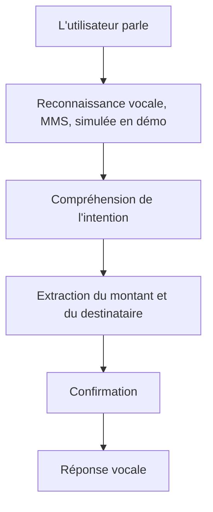

# KwèGbaTché

Assistant financier vocal en fon, en yoruba et en français, pour le mobile money. L'utilisateur peut consulter un solde, préparer un transfert vers un contact, comprendre les frais, suivre un budget, et confirmer à la voix avant tout transfert.

Projet de l'équipe KwèGbaTché pour le GPU Challenge 2026 (Epitech Bénin). Le parcours de démonstration s'appuie sur un portefeuille et des contacts fictifs.

## Architecture



Le serveur de démonstration est `app/backend`. Si le service de reconnaissance ne répond pas, la transcription est factice et le libellé « Reconnaissance vocale simulée (démo) » s'affiche. La compréhension d'intention utilisée par ce parcours est locale (`app/backend/src/ml/nlu.client.js`). La synthèse vocale distante a aussi un repli local si son service est injoignable.

## Dossiers

- `app/backend/` : API Node.js, base SQLite, page `/app` (`public/app.html`).
- `app/frontend/` : note sur l'interface. L'écran servi en démo est celui de `app/backend/public/`.
- `collect/` : collecte de voix en fon, yoruba et français. Mode d'emploi dans `collect/README.md`. Site public : https://kwegbatche-collecte.vercel.app
- `ml/asr/`, `ml/nlu/`, `ml/tts/` : notes sur la reconnaissance, les intentions et la synthèse.
- `data/` : métadonnées des corpus. Les fichiers audio lourds ne sont pas versionnés.
- `eval/` : notes d'évaluation.
- `docs/` : cahier des charges.

## Lancement

Node.js LTS.

```bash
git clone https://github.com/Olouwatobi-heberge/kwegbatche.git
cd kwegbatche/app/backend
npm install
node src/db/seed.js
npm start
```

Ouvrir http://localhost:3030/app

Les tests, depuis `app/backend` :

```bash
npm test
```

`npm test` enchaîne les 25 tests unitaires puis les 6 tests d'intégration.

Sur un téléphone, le micro du navigateur exige HTTPS :

```bash
npx cloudflared tunnel --url http://localhost:3030
```

Ouvrir l'adresse `https` affichée par la commande, en ajoutant `/app`.

Variables facultatives lues par `app/backend/src/config/index.js` (aucune valeur secrète) :

| Variable | Défaut dans le code | Rôle |
| --- | --- | --- |
| `PORT` | `3030` | Port du serveur |
| `ASR_SERVICE_URL` | `http://localhost:5001` | Reconnaissance vocale |
| `NLU_SERVICE_URL` | `http://localhost:5002` | Service d'intentions prévu dans la configuration |
| `TTS_SERVICE_URL` | `http://localhost:5003` | Synthèse vocale |

Si `ASR_SERVICE_URL` ne répond pas, le backend journalise une transcription FACTICE et poursuit. Si `TTS_SERVICE_URL` ne répond pas, il renvoie un audio de repli. Le parcours `/app` n'appelle pas `NLU_SERVICE_URL` : l'intention est calculée dans le processus Node.

## Démo

1. Ouvrir `/app` et choisir la langue (fon, yoruba ou français).
2. Choisir un cas : Solde, Envoyer 5000 à Koffi, ou Frais.
3. Appuyer sur le micro et parler.
4. Pour un transfert, confirmer avec le bouton ou avec le micro suivant.
5. Quand le service vocal est absent, l'interface affiche « Reconnaissance vocale simulée (démo) ».

Sans cas choisi, les tours se succèdent : solde, transfert, frais.

## Résultats

WER du modèle MMS `facebook/mms-1b-all`, sans entraînement, sur 223 enregistrements de la plateforme de collecte (https://kwegbatche-collecte.vercel.app) :

| Langue | WER | CER |
| --- | --- | --- |
| Fon | 73,6 % | 32,6 % |
| Yoruba | 71,3 % | 31,2 % |
| Français | 45,6 % | 19,5 % |

Classifieur d'intentions (TF-IDF sur les caractères et régression logistique, 7 intentions, validation croisée à 5 plis), comparé à une référence par mots-clés. Les chiffres sont des F1 :

| Langue | Classifieur | Mots-clés |
| --- | --- | --- |
| Français | 0,80 | 0,71 |
| Fon | 0,79 | 0,68 |
| Yoruba | 0,87 | 0,62 |

Fiche complète : https://docs.google.com/document/d/1m7mdSZtV-G4m_lyVr37vFclvrvBtzOHF5h04W0tsgbk/edit?usp=sharing

Tests automatiques du backend : 25 unitaires et 6 d'intégration.

## Limites

- En démonstration, la reconnaissance vocale est simulée.
- MMS n'est pas encore affiné : pas d'accès GPU pour cet entraînement.
- Les enregistrements de la collecte ne sont pas validés à la main.
- Un locuteur domine en fon et en yoruba.
- Les textes ont été lus.
- Les phrases de démonstration sont présentes dans l'entraînement du classifieur.
- Le portefeuille et les contacts sont fictifs.

## Suite

Affiner les adaptateurs MMS fon et yoruba sur GPU, faire valider les enregistrements par des humains, enregistrer davantage de locuteurs, puis brancher un vrai service de mobile money.

## Équipe

GPU Challenge 2026, Epitech Bénin.

- Amos BYLL-CATARIA : modèles vocaux.
- Merveille GOMEZ : données et classifieur.
- Andy KOUMAGNON : backend et application.
- Lovia KOUNOUHO : coordination, script, présentation.

Le code de ce dépôt est sous licence MIT (`LICENSE`).
